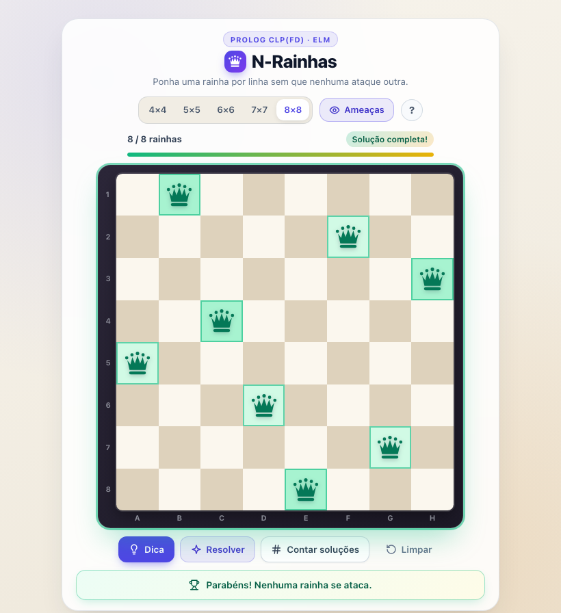

# N-Rainhas

## 1. Identificação

| Nome completo | Matrícula | Turma (14h/16h) | Usuário GitHub |
|---------------|-----------|-----------------|----------------|
| Flávio Melo   | 211030602 | 16h             | [@flavioovatsug](https://github.com/flavioovatsug) |
| [Nome]        | [000000]  | [16h]           | [@usuario]     |
| [Nome]        | [000000]  | [14h]           | [@usuario]     |

- **Nome do projeto:** N-Rainhas
- **Nome do grupo:** [nome do grupo]
- **Repositório:** [https://github.com/...]
- **Commit ou tag entregue:** [`v1.0`]
- **Ponto de partida:** outro jogo conhecido
- **Slides da apresentação oral:** não há

## 2. Resumo

Um site onde se joga o quebra-cabeça das N-Rainhas (tabuleiros de 4x4 a
8x8): o jogador põe rainhas clicando nas casas e precisa colocar N rainhas
sem que nenhuma ataque outra. O Prolog descreve as regras como restrições
CLP(FD) e, a partir delas, completa o tabuleiro, dá dicas e conta quantas
soluções existem com as rainhas já postas. O Elm desenha o tabuleiro e marca
na hora as rainhas em conflito.



## 3. Como executar

**Requisitos** (com as versões que o grupo usou):

- SWI-Prolog 10.0.2
- Node.js 22.13
- uv 0.6 (Python 3.13, instalado pelo uv)

**Instalação e execução:**

```sh
make install
make dev
# abrir http://localhost:5174
```

**Testes:**

```sh
make test
```

**Testado em:** macOS, Google Chrome

## 4. Arquitetura

```
[Elm, navegador] --HTTP/JSON--> [Python, FastAPI] --janus--> [SWI-Prolog]
```

| Parte  | Responsabilidade | Arquivos principais |
|--------|------------------|---------------------|
| Prolog | Regras do jogo, resolver, contar soluções, dica | `backend/prolog/rainhas.pl` |
| Elm    | Estado do jogo, conflitos instantâneos, tela | `frontend/src/Main.elm`, `frontend/src/Rainhas.elm`, `frontend/src/Api.elm` |
| Python | Só integração (rotas HTTP chamando o Prolog) | `backend/app/main.py`, `backend/app/prolog.py` |

## 5. Parte em Prolog

### 5.1 Predicados principais

| Predicado | Local | O que faz |
|-----------|-------|-----------|
| `solucao(+Parcial, -Rainhas)` | `backend/prolog/rainhas.pl:34` | Gera, por backtracking, cada solução que mantém as rainhas de `Parcial` |
| `restricoes(+Parcial, -Rainhas)` | `backend/prolog/rainhas.pl:42` | Declara as regras: colunas 1..N, colunas distintas, diagonais livres |
| `diagonais_livres(+Rainhas)` | `backend/prolog/rainhas.pl:58` | Nenhum par de rainhas na mesma diagonal |
| `resolver(+Parcial, -Solucao)` | `backend/prolog/rainhas.pl:72` | A primeira solução; falha se não houver |
| `contar_solucoes(+Parcial, -Total)` | `backend/prolog/rainhas.pl:79` | Quantas soluções completam o tabuleiro |
| `dica(+Parcial, -Dica)` | `backend/prolog/rainhas.pl:87` | `[Linha, Coluna]`, `completo` ou `impossivel` |

### 5.2 Conceitos do paradigma lógico utilizados

- [x] Fatos e regras como base de conhecimento: `manter_rainha/2` e `nao_ataca/3` (`rainhas.pl:51`, `rainhas.pl:63`)
- [x] Unificação e casamento de padrões: cabeças `[Rainha | Abaixo]` e `manter_rainha(0, _)` (`rainhas.pl:51-64`)
- [x] Recursão (inclusive sobre listas): `diagonais_livres/1` e `nao_ataca/3`
- [x] Backtracking e múltiplas soluções: `solucao/2` devolve todas as soluções; `contar_solucoes/2` percorre todas
- [x] `findall/3`, `bagof/3`, `setof/3` ou similares: `aggregate_all(count, ...)` em `rainhas.pl:80`
- [x] Corte (`!`) ou negação (`\+`), e por que foram necessários: sem corte explícito; `once/1` em `resolver/2` (`rainhas.pl:73`) para parar na primeira solução, e `->` em `dica/2` para escolher um único caso
- [x] Programação por restrições (CLP(FD) ou outra): `ins`, `#=`, `#\=`, `all_distinct`, `labeling` em `rainhas.pl:34-67`
- [x] Predicados de ordem superior (`maplist`, `foldl`, `include`...): `maplist(manter_rainha, Parcial, Rainhas)` em `rainhas.pl:46`

### 5.3 Trecho em destaque

```prolog
solucao(Parcial, Rainhas) :-
    restricoes(Parcial, Rainhas),
    labeling([ff], Rainhas).

restricoes(Parcial, Rainhas) :-
    length(Parcial, N),
    length(Rainhas, N),
    Rainhas ins 1..N,
    maplist(manter_rainha, Parcial, Rainhas),
    all_distinct(Rainhas),
    diagonais_livres(Rainhas).
```

Cada linha do tabuleiro vira uma variável cujo valor é a coluna da rainha.
`restricoes/2` não busca nada: só declara o que uma solução precisa
satisfazer (colunas válidas, as rainhas que o jogador já pôs, colunas
diferentes e nenhuma diagonal compartilhada). A regra "uma rainha por linha"
nem aparece: ela vem da própria representação. Depois, `labeling/2` pede ao
CLP(FD) que ache valores; a cada escolha o resolvedor propaga as restrições e
corta colunas impossíveis das outras linhas, e o backtracking volta quando
chega a um beco. Não escrevemos o algoritmo de busca: o mesmo `solucao/2`
serve para achar uma solução (`resolver/2`, com `once`), contar todas
(`contar_solucoes/2`) e dar dica (`dica/2`). Por isso a solução é lógica e
não a tradução de um laço imperativo.

## 6. Parte em Elm

### 6.1 Modelo e mensagens

```elm
type Tabuleiro
    = Tabuleiro (List (Maybe Int))

type alias Model =
    { tabuleiro : Tabuleiro
    , status : Status
    }

type Status
    = Jogando
    | Esperando
    | Aviso String
    | Falha String

type Msg
    = Clicou Int Int
    | MudouTamanho Int
    | Limpou
    | PediuDica
    | PediuSolucao
    | PediuContagem
    | RecebeuDica (Result String ( Int, Int ))
    | RecebeuSolucao (Result String Tabuleiro)
    | RecebeuContagem (Result String Int)
```

- `Tabuleiro` (`frontend/src/Rainhas.elm:26`) guarda um `Maybe Int` por
  linha: `Nothing` é linha vazia, `Just coluna` é a rainha. Com isso é
  impossível representar duas rainhas na mesma linha, e o tipo é opaco: fora
  do módulo só se mexe nele pelas funções exportadas.
- `Status` (`frontend/src/Main.elm:37`) é um custom type em vez de
  `carregando : Bool` mais `erro : Maybe String`: só um estado vale por vez,
  e não existe "carregando e com erro" ao mesmo tempo.
- A vitória não é guardada no modelo: é calculada do tabuleiro por
  `Rainhas.venceu` (`frontend/src/Rainhas.elm:103`), então nunca fica
  desatualizada.
- As respostas do servidor chegam como `Result String a`, e o `case` em
  `update` (`frontend/src/Main.elm:67`) obriga a tratar `Ok` e `Err`.

### 6.2 Conceitos do paradigma funcional utilizados

- [x] Arquitetura Elm (Model, update, view): `frontend/src/Main.elm`
- [x] Custom types e `case` exaustivo: `Status` e `Msg` em `frontend/src/Main.elm:37-63`
- [x] `Maybe` e `Result` no lugar de null e exceções: `rainhaEm` (`frontend/src/Rainhas.elm:42`) e as mensagens `Recebeu...`
- [x] Funções de ordem superior e aplicação parcial: `Api.resolver = post "/api/resolver" decoder` (`frontend/src/Api.elm:14-33`)
- [x] Composição (`|>`, `>>`): `paraLista` (`frontend/src/Rainhas.elm:123`) e `rainhaEm`
- [x] Decoders e encoders JSON: `frontend/src/Api.elm:21-48`
- [x] Comandos e subscriptions (efeitos controlados): as requisições são `Cmd Msg` devolvidos pelo `update`
- [x] Imutabilidade e atualização de records: `{ model | tabuleiro = ... }` em `update`
- [x] Outro: tipo opaco `Tabuleiro`, separando o domínio puro (`Rainhas.elm`) de HTTP (`Api.elm`) e da tela (`Main.elm`)

### 6.3 Trecho em destaque

```elm
emConflito : Int -> Tabuleiro -> Bool
emConflito linha tabuleiro =
    case rainhaEm linha tabuleiro of
        Nothing ->
            False

        Just coluna ->
            List.any (ataca ( linha, coluna )) (rainhas tabuleiro)
```

`rainhaEm` devolve `Maybe Int`, então o compilador obriga a tratar a linha
vazia. `ataca ( linha, coluna )` é aplicação parcial: vira uma função que
recebe outra posição e diz se ela ataca esta, e `List.any` a aplica a todas
as rainhas. A `view` usa essa função para pintar as rainhas em conflito na
hora, sem ir ao servidor.

## 7. Integração

| Rota / chamada | Entrada | Saída | Predicado Prolog |
|----------------|---------|-------|------------------|
| `POST /api/resolver` | `{"tabuleiro": [0,0,0,0]}` | `{"tabuleiro": [2,4,1,3]}` ou 422 | `resolver/2` |
| `POST /api/dica` | `{"tabuleiro": [2,0,0,0]}` | `{"linha": 2, "coluna": 4}` ou 422 | `dica/2` |
| `POST /api/contar` | `{"tabuleiro": [0,0,0,0]}` | `{"total": 2}` | `contar_solucoes/2` |

O tabuleiro é uma lista com a coluna (1..N) da rainha de cada linha, ou 0.
O Elm converte para `Maybe Int` com colunas a partir de 0 em
`frontend/src/Rainhas.elm:121`.

## 8. Testes e validação

- 11 testes plunit em `backend/prolog/test_rainhas.pl`: solução do 4x4,
  manutenção das rainhas postas, contagens conhecidas (2 no 4x4, 92 no 8x8),
  dica, tabuleiro completo e tabuleiro impossível.
- 6 testes pytest em `backend/tests/test_api.py`: rotas, JSON e status 422.
- Casos de borda: tabuleiro 3x3 sem solução, duas rainhas na mesma coluna
  ou diagonal (sem solução, 422), dica com tabuleiro completo (422),
  tabuleiro de tamanho inválido (422 do Pydantic), backend desligado (o Elm
  mostra "Sem conexão com o servidor").
- Teste manual no navegador: pôr rainhas, ver conflitos em vermelho, usar
  os quatro botões e trocar o tamanho.

## 9. Limitações e problemas conhecidos

- Tamanhos só de 4 a 8: em tabuleiros maiores a contagem de soluções fica
  lenta (o número de soluções cresce muito).
- A regra de ataque está escrita duas vezes: no Prolog (para resolver) e no
  Elm (para marcar conflitos sem esperar o servidor).
- A dica sempre usa a primeira linha vazia; não explica o porquê da jogada.
- Com mais tempo: tabuleiros maiores, explicar a dica e um cronômetro.

## 10. Contribuição de cada integrante

| Integrante | Principais contribuições |
|------------|--------------------------|
| Flávio Melo | [contribuições] |
| [Nome]     | [contribuições] |
| [Nome]     | [contribuições] |

## 11. Fontes, código de terceiros e uso de IA

**Código reaproveitado.** Partimos do template do Sudoku da disciplina.
Mantivemos a estrutura (Makefile, integração Python com janus, Vite, o
tratamento de erros HTTP em `Api.elm`). O Prolog (`rainhas.pl`), os testes e
os módulos `Rainhas.elm` e `Main.elm` foram reescritos para as N-Rainhas.

**Referências.** Documentação do SWI-Prolog (CLP(FD) e janus), guia oficial
do Elm, documentação do daisyUI.

**Uso de ferramentas de IA.**

- **Faixa de uso no código:** intensivo

| Ferramenta | Para que foi usada | Como o grupo verificou o resultado |
|------------|--------------------|------------------------------------|
| Claude (Anthropic) | Gerou a maior parte do código Prolog, Elm e Python e o rascunho deste relatório | Rodamos os testes (`make test`), testamos no navegador e revisamos cada arquivo para conseguir explicá-lo |

## 12. Apresentação oral

- **Slides:** não há
- **Roteiro:**

| Parte | Duração | Quem apresenta |
|-------|:-------:|----------------|
| Contexto e objetivo | 2 min | Flávio Melo |
| Demonstração | 5 min | [Nome] |
| Código Prolog | 3 min | [Nome] |
| Código Elm | 3 min | Flávio Melo |
| Limitações e aprendizados | 2 min | [Nome] |

## 13. Reflexão sobre os paradigmas

Em Prolog, resolver as N-Rainhas foi descrever as regras: colunas
diferentes (`all_distinct`) e diagonais livres (`abs(Rainha - Outra) #\=
Distancia`). Numa linguagem imperativa teríamos de escrever a busca com
retrocesso à mão, com laços e listas de colunas ocupadas. O mais
interessante é que o mesmo `solucao/2` serve para três coisas (resolver,
contar e dar dica) só mudando como é chamado: `once/1`, `aggregate_all/3` ou
dentro de um `->`. O mais difícil foi pensar na ordem: as restrições precisam
ser postas antes do `labeling`, senão a busca vira força bruta.

Em Elm, a mudança foi pensar primeiro nos tipos. Representar o tabuleiro
como `List (Maybe Int)` fez a regra "uma rainha por linha" desaparecer do
código, porque o tipo não permite o erro. O compilador também impediu
esquecer casos: ao acrescentar `PediuContagem` e `RecebeuContagem` ao `Msg`,
ele apontou o `update` até que todos os casos fossem tratados, e o `Result`
das requisições obrigou a mostrar as mensagens de erro do servidor.
